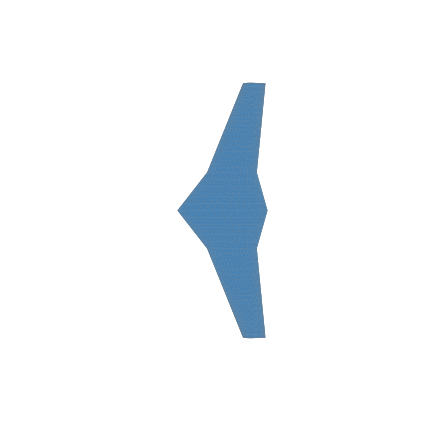
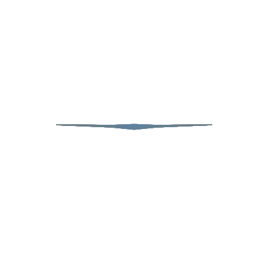
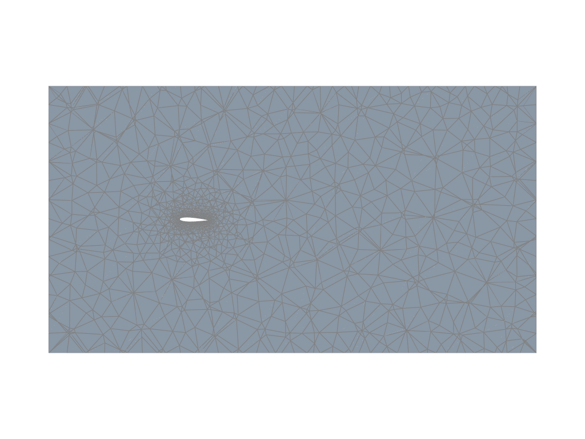
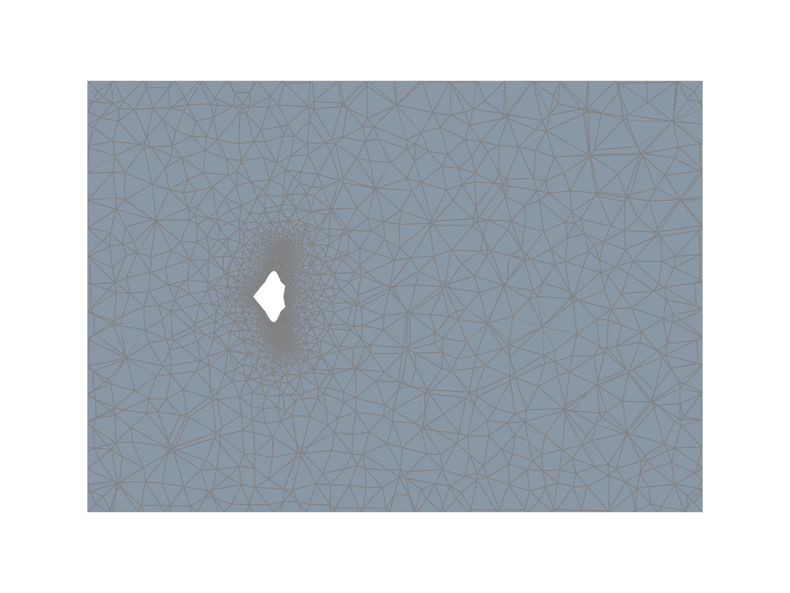
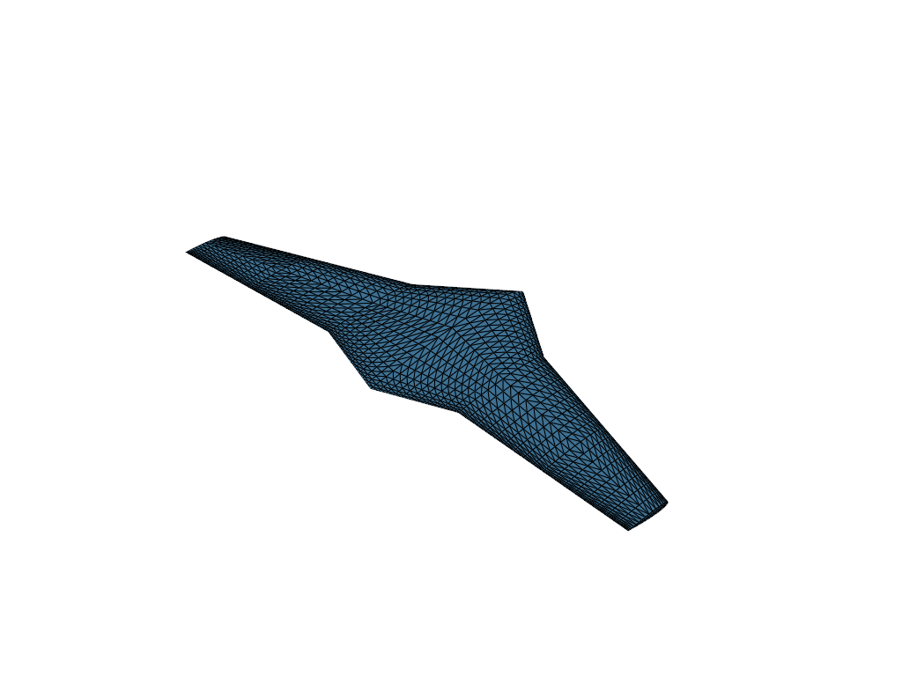
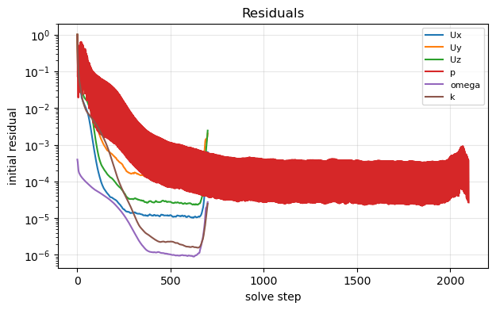
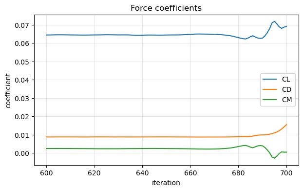
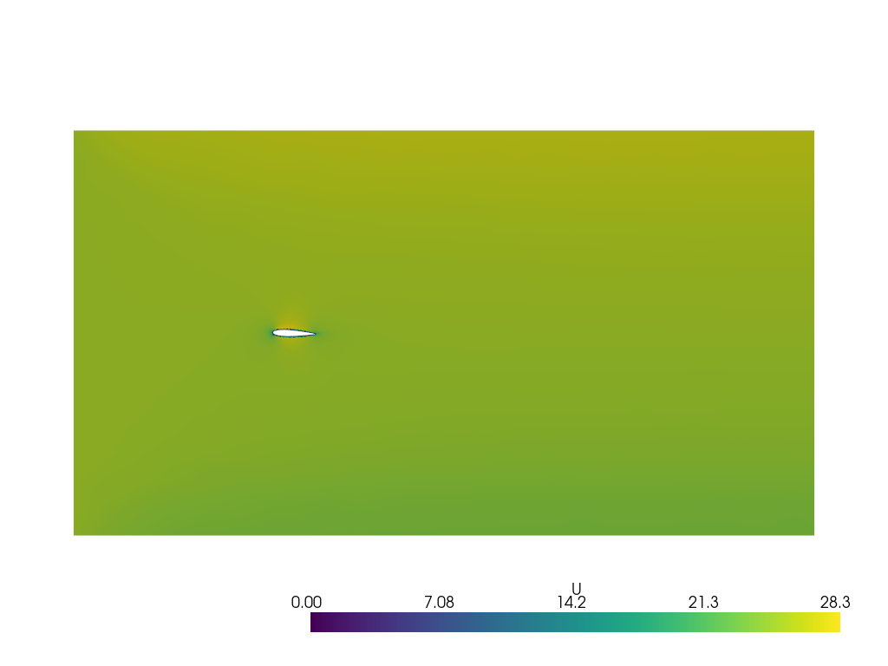
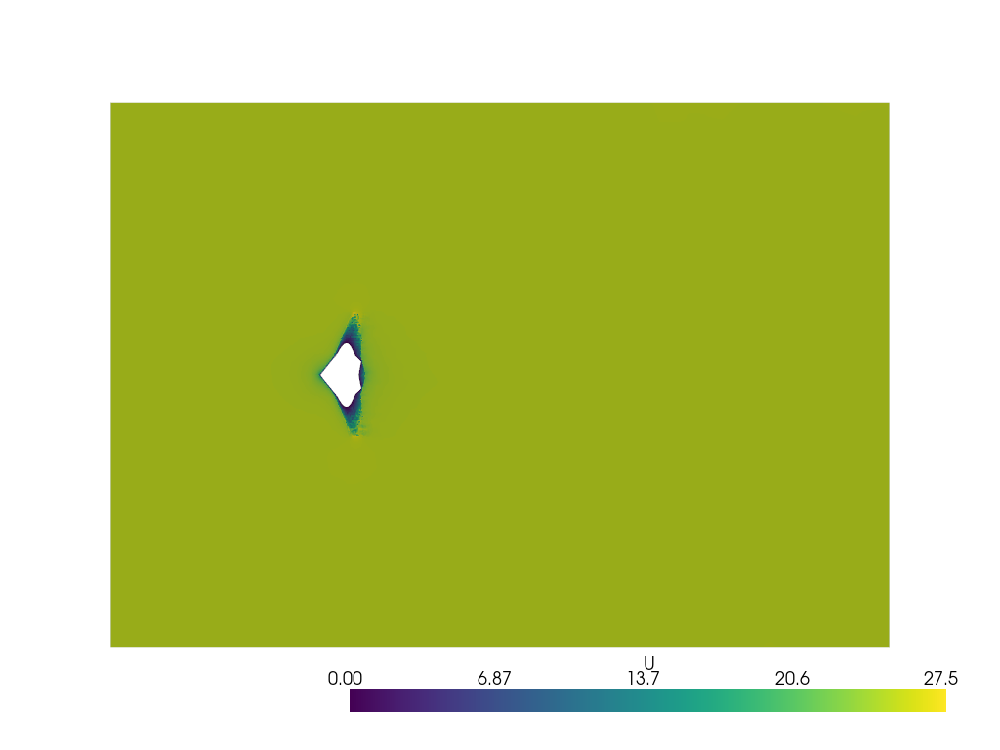
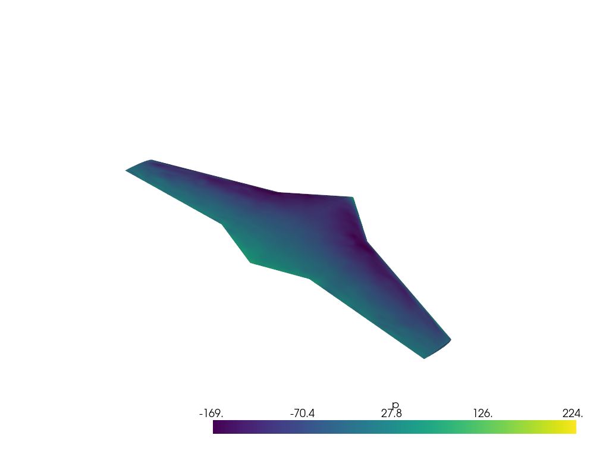

# Astra BWB Design Agent — Phase 1 + 2 Build & Verification Report

**Date:** 2026-07-10 · **Repo:** `Foam-Agent` fork (Astra) · **Machine:** Windows 11 + WSL Ubuntu-22.04, OpenFOAM v10, RTX 3060-class laptop

---

## 1. What was built

A natural-language → geometry → mesh → CFD → evaluation design loop for a **blended-wing-body (BWB) drone**, layered on the existing Foam-Agent graph (which was **not modified** for orchestration — all CFD flows through the stock planner → input_writer → runner → reviewer pipeline via its custom-mesh path).

| Layer | New component | Where |
|---|---|---|
| Intent (democratization) | Casual prompt → MissionSpec → derived physics (required CL from L=W, Reynolds no., turbulence model, static-margin target), every assumption logged | `src/services/intent.py`, `domain_packs/bwb/defaults.py` |
| Geometry | Parametric BWB in OpenVSP (12 parameters, hard ranges + engineering cross-checks), watertight STL, multi-view renders | `domain_packs/bwb/vsp_builder.py`, `src/services/geometry.py` |
| Fast aero (tier 1) | VSPAERO vortex-lattice alpha sweep → CL_α, trim α, L/D, neutral point | `domain_packs/bwb/vsp_aero.py`, `src/services/vspaero.py` |
| Mesh | Deterministic Gmsh farfield tet mesh around the STL, `checkMesh` gates, review renders | `domain_packs/bwb/gmsh_farfield.py`, `src/services/bwb_mesh.py` |
| CFD (tier 2) | The **existing Foam-Agent graph, unchanged**, fed the approved `.msh` via `--custom_mesh_path` (tandem-wing precedent) | `src/services/simulate.py` |
| Evaluation | Result-quality gates Foam-Agent lacks: convergence, plausibility vs VSPAERO, mission-target check, per-run visual report, verdict routing (pass / revise-numerics / revise-design / reject) | `src/services/evaluate.py` |
| Sessions | Versioned per-stage store with any-stage rollback (`runs/design_sessions/<sid>/<stage>/v<N>`) | `src/services/design_session.py` |
| Interface | 6 new MCP tools driven from Claude Code chat: `plan_design`, `build_geometry`, `run_fast_aero`, `generate_mesh`, `run_simulation`, `evaluate_results` | `src/mcp/fastmcp_server.py` |

**Environment work:** OpenVSP 3.49.0 installed in WSL (`/opt/OpenVSP`, needed a toolchain-PPA libstdc++ upgrade); its Python binding is locked to Python 3.10, so it runs in a dedicated venv (`/opt/vsp-venv`) driven by subprocess — invisible in normal use.

## 2. The three verification cases (user-specified)

1. **V1 Golden path** — one command, zero revisions, fully autonomous: casual prompt → plan → geometry → fast aero → mesh → CFD **through the existing graph** → evaluation with plots. PASS/FAIL table per stage, artifacts on disk.
2. **V2 Revisions** — one meaningful, documented change per stage: geometry (span +10%), mesh (coarse→medium), simulation (restart with extended endTime), visualization (extra slice plane); verifying versioning, old-version retention, downstream invalidation.
3. **V3 Gates (adversarial)** — alternating bad/good inputs; every bad input must die at the *right* gate with the *right* reason code, every good input must carry the loop forward.

---

## 3. The test campaign — run by run

Each golden-path run failed one layer deeper than the last. Every failure was a real defect that would have surfaced in production use.

### Run 1 — Phase-1 scope (intent + geometry only) — **PASS**
- LLM parsed the casual prompt correctly (2 kg, 25 m/s, 100 m, hand-launch); derived physics self-consistent (lift=weight to <1%); OpenVSP built a watertight BWB whose planform area hit the sizing target exactly.
- V2 (geometry versioning) 9/9, V3 (parameter gates) 8/8 at this scope.

### Run 2 — first full-loop attempt — **FAIL at mesh conversion**
- **Finding:** `gmshToFoam` crashed: *"fileName::stripInvalid"* — **OpenFOAM rejects paths containing spaces**, and the repo lives at `E:\cursor projects\...`. The `/opt/Foam-Agent` symlink doesn't save you: Python's `getcwd()` resolves symlinks to the physical path.
- **Change:** all OpenFOAM-touching runtime artifacts moved to a native WSL path (`~/astra_runs`), configurable via `ASTRA_RUNS_DIR`.

### Run 3 — **FAIL at mesh generation (0 cells)**
- **Finding:** Gmsh's parallel HXT algorithm **silently produced zero volume cells** under system load (worked interactively, failed in the real run); the failure only surfaced downstream at conversion.
- **Change:** switched to the deterministic Delaunay algorithm; added a hard zero-cell gate at the generator.

### Run 4 — **FAIL at mesh generation (overlapping facets)**
- **Finding:** Delaunay is stricter than HXT: the STL→CAD surface reparametrization step created **overlapping facets at the sharp trailing edge** ("28 elements remain invalid…").
- **Change:** stopped remeshing the surface entirely — the watertight OpenVSP STL triangles are used directly as the boundary mesh (Gmsh discrete-topology pattern); only the volume is meshed. Result: clean 97k-cell mesh, `checkMesh` OK.

### Run 5 — **FAIL in the graph (wrong mesh route)**
- **Finding:** the aircraft patch in the generated case had **0 faces** and a stray `generate_mesh.py` appeared: Foam-Agent's LLM mesh-type classifier read the phrase *"provided as a **Gmsh** .msh file"* and routed to **gmsh_mesh** ("write your own mesh script") instead of **custom_mesh** ("use the provided file"). The reviewer burned all 10 loops fighting the resulting junk mesh.
- **Change:** requirement wording changed to "a custom mesh file is provided — use it as-is; do NOT write any mesh-generation script". One word ("Gmsh") had flipped an LLM router.

### Run 6 — **FAIL in the graph (upstream Foam-Agent bug)**
- **Finding:** routing now correct, but `constant/polyMesh` never appeared: inside `copy_custom_mesh`, the **LLM-generated minimal controlDict contained markdown code fences**, crashing `gmshToFoam`'s dictionary parser — and the error was **silently swallowed** (no print, no gate).
- **Change (fork hardening):** fence stripping + fallback to a static valid controlDict + failure now printed as `<meshing_error>`. A second variant (stray closing fence with no opening fence) was caught and fixed in run 7.

### Run 7 — **FAIL at evaluation — and this is the system working**
- **Finding:** the graph completed "successfully", but the evaluator **rejected the physics**: CL ≈ 10⁶³, residuals stuck at 9×10⁻² — a fully diverged solution behind a clean exit code. This is precisely the result-level gate Foam-Agent lacks (their own papers name it as future work).
- **Diagnosis:** `laplacianSchemes Gauss linear corrected` — unlimited non-orthogonal correction on a tet mesh with **86° max non-orthogonality** is a textbook divergence recipe.
- **Change:** requirement now pins tet-mesh numerics: limited schemes (`limited corrected 0.33`), cellLimited gradients, non-orthogonal correctors.

### Run 8 — **FAIL again in the graph (wall-type roulette), then at evaluation (k blow-up)**
- **Finding A:** `gmshToFoam` creates every patch as generic `patch`, but wall functions abort unless the aircraft is type `wall`. Instructing the run script to fix it worked in some runs and not others — LLM compliance is a coin flip.
- **Change A (fork hardening):** `copy_custom_mesh` now **classifies wall patches itself** (one constrained LLM call) and fixes the boundary file deterministically *before* the input writer reads it — so generated BCs are consistent by construction.
- **Finding B:** with correct schemes and BCs the solve still diverged at ~iteration 300 via **turbulence (k) blow-up** on sliver cells at the sharp trailing edge. A controlled experiment (laminar run on the same mesh also diverged) proved the **mesh, not the turbulence model**, was the root cause.
- **Change B:** added a **Netgen optimization pass** to the mesher (avg non-orthogonality 22.6→17.9, max skewness 2.6→1.5) plus **bounded divergence schemes** and k/ω relaxation 0.3. Direct solver tests: laminar continuity 10⁻⁶; kOmegaSST 600 iterations, zero bounding events, continuity 10⁻⁶. **Converged.**

### Run 9 — full loop **converges**; last gap: missing post-processing
- **Finding:** residuals 2.5×10⁻⁵, clean field renders — but the input writer had omitted the forceCoeffs/yPlus function objects, so there was no CL to judge.
- **Change:** the evaluator became self-sufficient — if force coefficients are missing it **injects the function objects and recomputes them post-hoc** from saved fields (`foamDictionary` + `simpleFoam -postProcess`). Deterministic; works on any finished case.

### Run 10 — full three-case sweep — **V1 29/30 · V2 13/14 · V3 13/13**
- **V1:** every machinery gate green. The one "FAIL" row was `meets_cl_target` — a **design outcome, not a defect**: coarse-mesh CFD CL 0.064 vs required 0.181, and the verdict correctly routed to **revise-design** (i.e., "refine the mesh or change the design", the honest engineering answer at y+≈900). Reporting was updated to mark outcome gates as informational; the asserted quantity is the verdict.
- **V2:** versioning, retention, downstream invalidation, mesh refinement (86k→215k cells), documented solver restart — all green. The one failure (extra z-slice render) traced to function-object side effects creating field-less time directories; the renderer now picks the latest time that actually contains a velocity field (fix verified — the z-slice renders).
- **V3:** all 13 adversarial checks green, including: bad numerics (bogus divergence scheme) run to a crash and **rejected by the evaluator**, then the good case accepted — the exact bad/good alternation specified.

The final clean-sweep rerun was **stopped mid-flight at the user's request** (it had already re-passed geometry/fast-aero/mesh); results above are from the last completed runs.

---

## 4. Physics results (golden design)

**Mission (from one casual sentence):** 2 kg payload, 25 m/s cruise, 100 m altitude, hand-launched.
**Derived (5 logged assumptions):** MTOW 6.67 kg → S = 0.952 m², span 2.29 m, AR 5.5, required cruise CL = 0.181, Re_MAC ≈ 8×10⁵, kOmegaSST.

| Quantity | VSPAERO (tier 1) | OpenFOAM RANS (tier 2, coarse 85k-cell mesh) |
|---|---|---|
| CL_α | 0.0708 /deg (≈ theory for AR 5.5) | — |
| Trim α for CL 0.181 | 2.27° | run at 2.27° |
| CL | 0.181 (by construction) | **0.065** (under-resolved BL, y+ ~ 900 — expected under-prediction; drives the revise-design verdict) |
| CD | 0.0105 (inviscid-ish → L/D 17.2) | 0.0102 |
| Neutral point | x_np = 0.410 m → CG target 0.372 m for 8% static margin | — |
| Convergence | — | residuals ≤ 2.5×10⁻⁵, continuity ~10⁻⁶ |

### Geometry (OpenVSP, auto-generated from the mission)

| | |
|---|---|
|  |  |
| Top view — swept centre body blending into tapered outer wings | Isometric view |
|  |  |
| Front view (dihedral visible) | Side view |

### Mesh (Gmsh farfield, 85k cells, checkMesh OK)

| | |
|---|---|
|  |  |
| Symmetry-plane slice — refinement collapsing onto the aircraft | Planform-plane slice |

*Aircraft surface triangulation (the watertight OpenVSP STL used directly as boundary mesh).*

### CFD results (converged kOmegaSST solution + 100-iteration restart)

| | |
|---|---|
|  |  |
| Residual histories — the two spikes are the V2 restart and post-hoc recompute; levels 10⁻⁵–10⁻⁶ | Post-hoc force coefficients |
|  |  |
| Velocity magnitude, symmetry plane — stagnation, acceleration over the body, wake | Velocity magnitude, planform plane (this is the V2 "extra slice" revision, verified) |

*Surface pressure on the aircraft — leading-edge suction visible.*

---

## 5. All changes made (chronological)

| # | File | Change | Why |
|---|---|---|---|
| 1 | `verification/_common.py` | `ASTRA_RUNS_DIR` → native WSL path | OpenFOAM rejects paths with spaces |
| 2 | `domain_packs/bwb/gmsh_farfield.py` | HXT → Delaunay; zero-cell gate | HXT silently produced 0 cells under load |
| 3 | `domain_packs/bwb/gmsh_farfield.py` | Direct-STL boundary (no surface remesh) | reparametrization corrupted the sharp TE |
| 4 | `src/services/simulate.py` | Requirement wording: "custom mesh provided" | the word "Gmsh" flipped the LLM mesh router |
| 5 | `src/services/mesh.py` (fork hardening) | Fence-strip + fallback controlDict; surface errors | LLM controlDict with markdown fences crashed gmshToFoam silently |
| 6 | `src/services/simulate.py` | Pinned tet-mesh numerics (limited/bounded schemes, relaxation) | unlimited correction on 86° non-ortho mesh diverges |
| 7 | `src/services/mesh.py` (fork hardening) | Deterministic wall-patch classification after conversion | gmshToFoam makes all patches `patch`; wall functions abort; LLM run-script compliance ~50% |
| 8 | `domain_packs/bwb/gmsh_farfield.py` | Netgen optimization pass | skew 2.6→1.5; raw Delaunay tets couldn't hold a steady solution |
| 9 | `src/services/evaluate.py` | Post-hoc function-object injection + recompute | input writer sometimes omits forceCoeffs/yPlus |
| 10 | `src/services/evaluate.py` | Tier-aware plausibility band; yPlus parser; U-bearing-time renderer | honest cross-fidelity band; patch-name words broke numeric parse; field-less time dirs broke renders |
| 11 | `src/services/__init__.py` | Lazy `global_llm_service` | LLM-free imports (geometry, sessions, verification) no longer need credentials; likely fixes the known `pytest` collection failure |

## 6. Key lessons (worth remembering for Phase 3+)

1. **"It ran" ≠ "it's right"** — the evaluator caught a fully diverged solution behind a clean exit code on its first real test. This result-level gate is the project's core differentiator and it demonstrably works.
2. **LLM steps must never be load-bearing for correctness** — the mesh router, the conversion controlDict, the wall-type instruction, and the function objects all failed probabilistically; each was replaced or backed by a deterministic mechanism.
3. **Mesh quality is the physics bottleneck** — schemes and BCs were fixable in requirement text; only mesh optimization made the solve converge. The Phase-3/4 mesh-convergence tier (coarse/medium/fine) is not optional bookkeeping, it is the trust story.
4. **The coarse tier under-predicts lift by ~2.8×** vs the vortex lattice at trim — exactly the cross-fidelity disagreement the future trust policy will learn from.

## 7. Open items

- Final clean-sweep rerun of all three cases (stopped at user request mid-run; all fixes verified individually).
- Boundary-layer resolution: y+ ≈ 900 on the coarse tier → CL under-prediction; medium/fine tiers or prism layers (gmsh BL fields) are the Phase-3 lever.
- V1 golden-path residual: the input writer's function-object omission is worked around post-hoc; a deterministic case-template injection would remove the workaround.
- MCP tools `run_simulation`/`evaluate_results` are wired but not yet exercised end-to-end from a live Claude Code chat session (services underneath are the verified paths).
